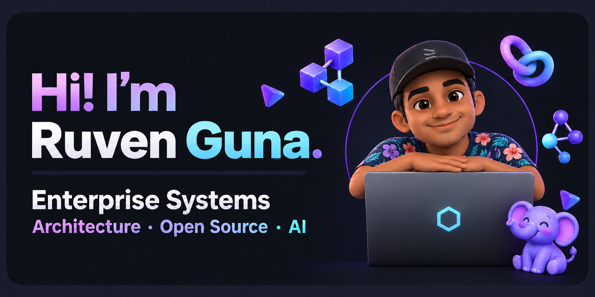

  

# Hi, I'm Ruven

I'm based in Singapore and work with enterprise data and AI systems. I'm interested in what happens between a promising demo and something people can actually use, particularly when it comes to integration, data access, security and evaluation.

I use GitHub to try things out and document what I learn along the way. Some projects are further along than others.

## A few projects

- [AI Assurance Workbench](https://github.com/RuvenGuna94/AI-assurance-workbench) — Testing a local LLM application with ASQI Engineer and Garak, and documenting the findings, limitations and supporting evidence.
- [Property Operations RAG Workbench](https://github.com/RuvenGuna94/property-ops-rag-workbench) — Bringing documents and structured asset records together to answer operational questions, while working through citations, access boundaries and tracing.
- [Experiments with AI Agents](https://github.com/RuvenGuna94/Experimenting-With-AI-Agents) — Exploring agent collaboration and task orchestration with CrewAI.
- [Dialogue Summarization with PEFT](https://github.com/RuvenGuna94/Dialogue-Summary-PEFT-Fine-Tuning) — Comparing full and parameter-efficient fine-tuning for a summarisation task.

## Outside of work

Before getting into tech, I used to DJ. These days, I spend some of my free time volunteering, including academic befriending and helping people understand and adopt AI through community learning.

You can also find me on [LinkedIn](https://www.linkedin.com/in/ruven-guna/).
