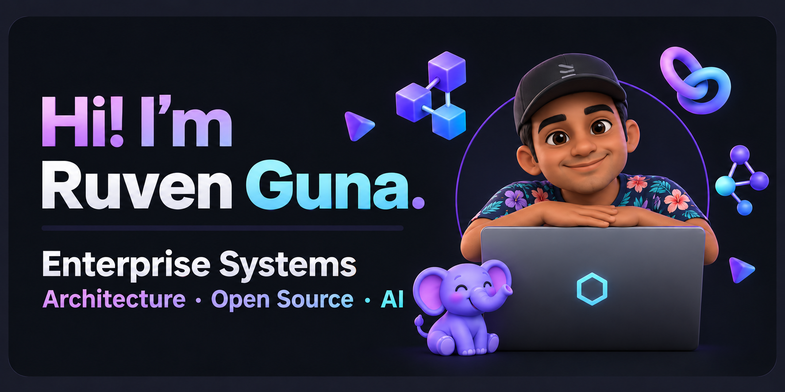

  

  <a href="https://www.linkedin.com/in/ruven-guna/">LinkedIn</a> ·
  <a href="https://github.com/RuvenGuna94?tab=repositories">Explore my repositories</a>

# Hi, I'm Ruven 👋

I'm a technology professional based in Singapore, interested in how enterprise systems, thoughtful architecture, and open-source tools can turn AI ideas into useful applications.

This GitHub is my workshop: a place to build workbenches, explore design choices, and learn through hands-on experiments in AI, data engineering, and cloud systems.

> The questions that interest me: How does it fit into the wider system? How can we observe it? And how do we know it works?

## Where my interests connect

| Area | What I like exploring |
| :--- | :--- |
| **Enterprise systems** | Connecting applications, data, and operational workflows |
| **Architecture** | Clear boundaries, integration patterns, and practical trade-offs |
| **Open source** | Building with tools that can be inspected, adapted, and run locally |
| **AI** | RAG, agents, model adaptation, evaluation, and assurance |

## Inside the workshop

### 🛡️ [AI Assurance Workbench](https://github.com/RuvenGuna94/AI-assurance-workbench)

A local lab for exploring how AI applications can be tested and reviewed, bringing together threat modelling, evidence review, and scorecard-based reporting.

**Explore:** AI assurance · security evaluation · reproducible experiments  
**Tools:** ASQI Engineer, Garak, Ollama, FastAPI, Python

### 🏗️ [Property Operations RAG Workbench](https://github.com/RuvenGuna94/property-ops-rag-workbench)

A property operations lab exploring how retrieval and tools can connect AI applications with documents and structured data, with observability in the workflow.

**Explore:** RAG architecture · data integration · tracing  
**Tools:** OpenRAG, S3, Google Drive, SQLite, OpenTelemetry, LangSmith

### 🧪 [Dialogue Summarization with PEFT](https://github.com/RuvenGuna94/Dialogue-Summary-PEFT-Fine-Tuning)

An experiment with FLAN-T5 dialogue summarization, comparing full fine-tuning with parameter-efficient fine-tuning and evaluating results using ROUGE.

**Explore:** model adaptation · evaluation · fine-tuning trade-offs

### 🤝 [Experiments with AI Agents](https://github.com/RuvenGuna94/Experimenting-With-AI-Agents)

A notebook exploring collaboration between AI agents using CrewAI, including research, content generation, and task orchestration.

**Explore:** agent collaboration · workflow automation · orchestration

<strong>More from the learning notebook</strong>

- [Safer dialogue summarization with PPO and PEFT](https://github.com/RuvenGuna94/Dialogue-Summary-remove-toxic-text-PPO) — exploring reward-based approaches to reducing toxicity in generated summaries.
- [LangChain application development](https://github.com/RuvenGuna94/LangChain-for-LLM-Application-Development) — course exercises and experiments with LLM application building blocks.

## Questions I'm exploring

- How can RAG systems connect to enterprise data while remaining understandable and observable?
- What evidence helps us assess an AI application's reliability and security?
- Where do agents add value to a workflow, and where is a simpler approach enough?
- How can local and open-source tools make experiments easier to reproduce?

## Let's connect

Interested in enterprise architecture, open-source systems, or practical AI? I'd enjoy exchanging ideas.

[Find me on LinkedIn →](https://www.linkedin.com/in/ruven-guna/)

